Rust audio, speech and media-transport engines, with WASM builds for the browser.

[wavey.ai](https://wavey.ai) · [yl.vin](https://yl.vin) · [Hush](https://wavey.ai/code/hush/) · [EnCodec in the browser](https://wavey.ai/code/encodec-rs/browser-smoke/) · [Folio](https://folio.wavey.ai) · [Needletail](https://needletail.wavey.ai)

### Audio and codecs

| Repository | Description | Fact |
| --- | --- | --- |
| [**soundkit**](https://github.com/wavey-ai/soundkit) | Rust media toolkit: demux, decode, encode and resample audio and video, native and WASM. | The MP3 decoder uses 2.17% less time per sample than minimp3 C over 60 files. 27,194 downloads on crates.io. |
| [**encodec-rs**](https://github.com/wavey-ai/encodec-rs) | EnCodec neural audio codec on WebGPU, WASM SIMD and Apple MLX. | Encodes 48 kHz stereo at 3, 6, 12 or 24 kbps. |
| [**mel-spec**](https://github.com/wavey-ai/mel-spec) | Whisper-compatible mel spectrograms, Kaldi filterbanks and a voice activity detector in Rust. | Whisper log-mel of 11 s of audio takes 1.97 ms on one M1 core. 1,682,115 downloads on crates.io. |
| [**stemsplits**](https://github.com/wavey-ai/stemsplits) | Four-stem HTDemucs music separation in Rust, with a WASM build. | One thread separates a 7.8 s segment in 12.6 s on Apple Silicon. ONNX Runtime on one thread takes 20.4 s. |
| [**mastering**](https://github.com/wavey-ai/mastering) | Rust mastering engine that renders up to four versions of a stereo mix. | The engine measures the mix, proposes a bounded change, renders it, then keeps or rejects the change. |
| [**mossnano-rs**](https://github.com/wavey-ai/mossnano-rs) | Rust and WASM tools for MOSS-Audio-Tokenizer-Nano token files. | One token frame is 3,840 samples, 80 ms at 48 kHz. |

### Records

| Repository | Description | Fact |
| --- | --- | --- |
| [**bitneedle**](https://github.com/wavey-ai/bitneedle) | Picture records: 576 × 576 PNG images that carry recoverable audio. | The programme band holds 20 bits of audio payload in each pixel. |
| [**record-player**](https://github.com/wavey-ai/record-player) | Rust audio engine for a record deck: platter, motor, slipmat, hand contact and scratching. | 156.6× realtime at 48 kHz, 0.6% of the audio callback budget. |
| [**vin.yl.prepress**](https://github.com/wavey-ai/vin.yl.prepress) | Record artwork preflight and CMYK PDF export in Rust, built for WASM. | Embeds the target ICC profile as the PDF output intent. |

### Live media transport

| Repository | Description | Fact |
| --- | --- | --- |
| [**web-services**](https://github.com/wavey-ai/web-services) | Rust server and proxy primitives for HTTP/1.1, HTTP/2, HTTP/3, WebSocket, WebTransport, SRT and RIST. | Four vCPUs served 269,074,634 HTTP/3 requests in one hour with 0 errors. |
| [**needletail**](https://github.com/wavey-ai/needletail) | Live media distribution mesh: a RaptorQ relay graph, regional edges and LL-HLS playback. | Ten nodes on GCP and Azure carried eight stereo tracks from London for 600 s. |
| [**playlists**](https://github.com/wavey-ai/playlists) | Fixed-capacity caches and manifest rendering for LL-HLS playlists and media parts. | Eight workers on an M1 publish 109,083 complete playlist updates per second. |
| [**raptor-fec**](https://github.com/wavey-ai/raptor-fec) | RaptorQ forward error correction for low-latency datagram transports. | The same datagrams travel over WebTransport and WebRTC data channels. |
| [**rist-rs**](https://github.com/wavey-ai/rist-rs) | RIST protocol engine in Rust, with librist bindings and C interop tests. | Main-profile plaintext and SRP roles interoperate with librist 0.2.20 in both directions. |
| [**av-mesh**](https://github.com/wavey-ai/av-mesh) | Cache mesh that replicates LL-HLS slots between regions over RaptorQ. | A recorded two-region run delivered 2,304,000 of 2,304,000 parts. |
| [**relay-session**](https://github.com/wavey-ai/relay-session) | RaptorQ relay sessions across a primary and a secondary parent. | Recovers an object across parents after five lost primary symbols. |
| [**media-object**](https://github.com/wavey-ai/media-object) | Canonical media-object key and binary envelope for relays. | Key: tenant / stream / track / epoch / group / object / version / SHA-256. |
| [**frame-header**](https://github.com/wavey-ai/frame-header) | Bit-packed headers for audio packets, in Rust and Objective-C. | A v1 header is 4 bytes. A v2 header is 8 bytes. |
| [**av-llhls**](https://github.com/wavey-ai/av-llhls) | TypeScript LL-HLS client for SoundKit frames with Opus WASM decode. | Reads /api/mesh from seed nodes, scores the edges and tails the best one. |
| [**shared-rb-js**](https://github.com/wavey-ai/shared-rb-js) | Multi-producer, multi-consumer ring buffer of typed-array frames on a SharedArrayBuffer. | 3,958,511 writes per second in the README benchmark. |

### Speech, vision and language models

| Repository | Description | Fact |
| --- | --- | --- |
| [**asr-api**](https://github.com/wavey-ai/asr-api) | Speech recognition service with a Deepgram-compatible /v1/listen API. | One RTX 4000 Ada processed 42.4 hours of cached 16 kHz audio at 78.37× realtime. |
| [**hush**](https://github.com/wavey-ai/hush) | Mel spectrogram, voice detection and Whisper transcription in the browser. | The audio stays in the browser. |
| [**cutout**](https://github.com/wavey-ai/cutout) | Background removal with BiRefNet_lite in Rust and WASM. | A 1024 × 1024 mask takes 6.6 s on eight M1 threads. PyTorch on the CPU takes 11.5 s. |
| [**llm-worker**](https://github.com/wavey-ai/llm-worker) | llama.cpp worker with an OpenAI-compatible /v1/chat/completions endpoint. | Qwen3.5-0.8B on an M1 Air: 124.6 tokens per second across 32 slots. |
| [**folio**](https://github.com/wavey-ai/folio) | JSON, XML and CSV to SQL reports in the browser. | On a 20-million-row table in PostgreSQL 18, a top-100 sort on any field takes 14 ms in json2Leaf rows. |

### Servers and identity

| Repository | Description | Fact |
| --- | --- | --- |
| [**zeroth**](https://github.com/wavey-ai/zeroth) | OIDC identity provider and social login broker for Cloudflare Workers and D1. | Passkeys, PKCE and ES256 tokens with key rotation, inside the 10 ms Workers Free CPU limit. |
| [**store-stream**](https://github.com/wavey-ai/store-stream) | Chunked object uploads with byte-range reads before the upload finishes. | Runs on S3, Google Cloud Storage or a local object store. |
| [**http-pack**](https://github.com/wavey-ai/http-pack) | Binary framing for HTTP/1.1, HTTP/2 and HTTP/3 messages. | The receiver rebuilds HTTP/1.1 and streams the body with chunked encoding. |
| [**lastcommit**](https://github.com/wavey-ai/lastcommit) | Cloudflare Worker that makes chosen private repositories public after a set time with no maintainer commits. | Dry run is the default. Repositories change only when LASTCOMMIT_ARMED is true. |

### More

[flac](https://github.com/wavey-ai/flac) · [access-unit](https://github.com/wavey-ai/access-unit) · [libfdk-aacjs](https://github.com/wavey-ai/libfdk-aacjs) · [encodec-api](https://github.com/wavey-ai/encodec-api) · [av-contrib](https://github.com/wavey-ai/av-contrib) · [rtmp-ingress](https://github.com/wavey-ai/rtmp-ingress) · [wrtc](https://github.com/wavey-ai/wrtc) · [message-packetizer](https://github.com/wavey-ai/message-packetizer) · [tcp-changes](https://github.com/wavey-ai/tcp-changes) · [st2110-caption-gateway](https://github.com/wavey-ai/st2110-caption-gateway) · [object-api](https://github.com/wavey-ai/object-api) · [av-api](https://github.com/wavey-ai/av-api) · [tls-helpers](https://github.com/wavey-ai/tls-helpers) · [discovery](https://github.com/wavey-ai/discovery) · [linode](https://github.com/wavey-ai/linode) · [kubeadm-cluster](https://github.com/wavey-ai/kubeadm-cluster) · [hyper-idp](https://github.com/wavey-ai/hyper-idp) · [hyper-idp-worker](https://github.com/wavey-ai/hyper-idp-worker) · [aws-mocks](https://github.com/wavey-ai/aws-mocks) · [s3-memory](https://github.com/wavey-ai/s3-memory) · [vin.yl.plant](https://github.com/wavey-ai/vin.yl.plant) · [inscribe](https://github.com/wavey-ai/inscribe) · [pagekit](https://github.com/wavey-ai/pagekit) · [codex-write-mitigation](https://github.com/wavey-ai/codex-write-mitigation)
